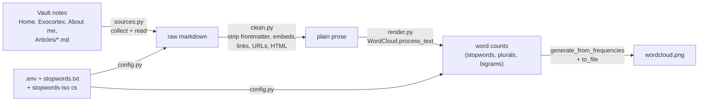

# Vault word cloud

A word cloud of the core writing on this site: [[Home]], [[Exocortex]], [[About me and my experience]] and every note in [[Articles]] (28 notes, ~270k characters after cleaning). Word size is proportional to how often the word appears, after Obsidian markup, URLs and filler words are removed.


**What stands out:** *AI* (336 mentions) is the largest word by a wide margin, followed by *LLM* (160), *model* (158), *science* (123), *human* (107), *mathematics* (103), *agent* (99) and *physics* (93). Multi-word terms the library detected as collocations include *deep learning* (82), *reinforcement learning* (74) and *mechanistic interpretability* (49). The exact top-30 list with counts is written to each run log.

## How it works



1. **Collect** (`sources.py`): the three listed notes plus the top-level `*.md` files of `Articles/`. A missing listed note raises an error rather than being skipped quietly.
2. **Clean** (`clean.py`): removes YAML frontmatter, code fences, image embeds (`![[…]]`, ``), bare URLs and HTML. Wikilinks become their visible text (`[[Home|exocortex]]` → *exocortex*), markdown links keep only their text, and typographic `’` becomes `'` so contractions match the stopword list.
3. **Count and draw** (`render.py`): [`wordcloud`](https://github.com/amueller/word_cloud) tokenizes, drops stopwords, numbers and one-letter tokens, merges plurals, and keeps strong bigrams. It then lays out the 200 most frequent terms on a 2000×1200 canvas with a fixed seed, so every run produces the same image.
4. **Log** (`logs.py`): every step is timestamped to the terminal and to `logs/run_<timestamp>.log`.

`main.py` is the thin wrapper that runs these phases in order.

### Stopwords
Hidden words come from three sources:
- `wordcloud.STOPWORDS`: the library's English list.
- [`stopwords.txt`](stopwords.txt): link-title labels (*Wikipedia*, *YouTube*, added by the auto-link-title plugin) and English filler (*etc*, *will*, *maybe*, …). It was chosen by reading the top-200 terms of the first run.
- The [stopwords-iso Czech list](https://github.com/stopwords-iso/stopwords-cs), because three Articles are partly in Czech. Without it, *je* ("is"), *co* ("what") and *ale* ("but") would rank 52nd, 76th and 122nd and appear in the cloud.

**Known limitation:** the Czech list also contains a few English words. The only one that occurs in these notes as English content is *design* (7 mentions). It is hidden, but the 200th word in the cloud has 15 mentions, so *design* wouldn't make the cut anyway.

## Usage

Requires [uv](https://docs.astral.sh/uv/). From this `Wordcloud/` folder:

```bash
uv sync
```

```bash
uv run vault-wordcloud
```

```bash
uv run pytest
```

`uv sync` creates the local `.venv`. `uv run vault-wordcloud` regenerates `wordcloud.png` (about 7 s) and `uv run pytest` runs the tests. To change sources, size, word count or stopword languages, copy `.env.example` to `.env` and edit it; every key is optional. To hide more words, add them to `stopwords.txt`. Plurals need their own line, because wordcloud drops stopwords *before* merging plurals.

## Features and technologies
- [`wordcloud`](https://github.com/amueller/word_cloud) 1.9.6 for tokenizing, collocations and layout ([API](https://amueller.github.io/word_cloud/generated/wordcloud.WordCloud.html))
- [`stopwordsiso`](https://github.com/bact/stopwords-iso) for non-English stopwords
- [`python-dotenv`](https://github.com/theskumar/python-dotenv) for `.env` config
- [uv](https://docs.astral.sh/uv/) for the project and lockfile, and [pytest](https://docs.pytest.org/) for tests (cleaning rules, config, and an end-to-end run on a temporary vault)
- Obsidian syntax handled per the [internal links](https://help.obsidian.md/Linking+notes+and+files/Internal+links) and [embeds](https://help.obsidian.md/Linking+notes+and+files/Embed+files) docs

## Files
| Path | Purpose |
|---|---|
| `src/vault_wordcloud/main.py` | wrapper that runs the phases in order |
| `src/vault_wordcloud/{config,sources,clean,render,logs}.py` | one module per phase |
| `tests/` | `test_clean.py`, `test_config.py`, `test_pipeline.py` |
| `stopwords.txt` | editable extra stopword list |
| `.env.example` | all config keys with defaults |
| `wordcloud.png` | the generated image |

`.venv/`, `logs/` and `.env` are gitignored, so the vault's auto-backup does not commit them.
