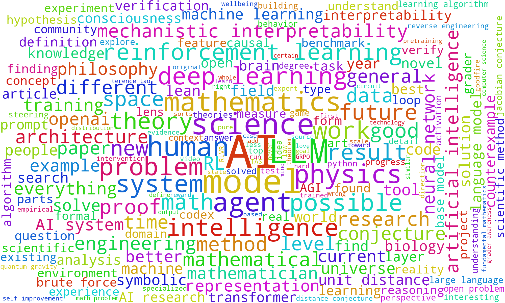
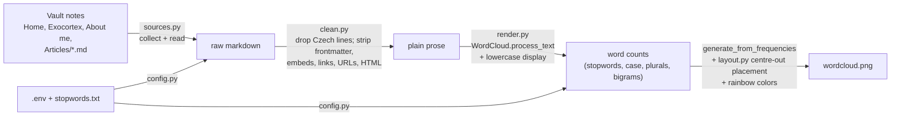

# Vault word cloud

A word cloud of the core writing on this site: [[Home]], [[Exocortex]], [[About me and my experience]] and every note in [[Articles]] (28 notes, ~259k characters after cleaning). Word size grows with how often the word appears, after Obsidian markup, URLs, Czech lines and filler words are removed. Counting ignores case, and words are shown in lowercase except all-caps acronyms such as *AI* and *LLM*. The most frequent words sit in the middle, and every word gets a random rainbow color.



**What stands out:** *AI* (331 mentions) is the largest word by a wide margin, followed by *model* (158), *LLM* (154), *science* (127), *human* (107), *mathematics* (103), *agent* (96) and *physics* (93). Multi-word terms the library detected as collocations include *deep learning* (80), *reinforcement learning* (72) and *mechanistic interpretability* (48). The exact top-30 list with counts is written to each run log.

## How it works



1. **Collect** (`sources.py`): the three listed notes plus the top-level `*.md` files of `Articles/`. A missing listed note raises an error rather than being skipped quietly.
2. **Clean** (`clean.py`):
   - **Czech lines are dropped.** A few Articles (mainly *How AGI pilled am I* and *Defining AGI and intelligence*) are partly in Czech. Any line containing a Czech-only letter (ě š č ř ž ů ň ť ď) is removed whole; English never uses these letters, so English lines are kept. Three short Czech lines without these letters ("Nebo tady … s Davidem Krakauerem" video links) slip through, but their words occur at most twice, far below the 15-mention cutoff for the cloud.
   - **Markup is stripped.** YAML frontmatter, code fences, image embeds (`![[…]]`, ``), bare URLs and HTML are removed. Wikilinks become their visible text (`[[Home|exocortex]]` → *exocortex*), markdown links keep only their text, and typographic `’` becomes `'` so contractions match the stopword list.
3. **Count and draw** (`render.py`, `layout.py`): [`wordcloud`](https://github.com/amueller/word_cloud) tokenizes, drops stopwords, numbers and one-letter tokens, merges case variants and plurals, and keeps strong bigrams. `display_case` then shows every word in lowercase except all-caps acronyms (*AI*, *LLM*, *RL*), so mixed-case names like *OpenAI* appear as *openai*. The 200 most frequent terms are drawn on a 2000×1200 canvas, largest first, with a fixed seed so every run produces the same image. Three things differ from the library defaults:
   - **Big words in the middle.** By default the library drops each word at a uniformly random free spot. `CenteredOccupancyMap` instead picks the free spot nearest the canvas center, measured on an ellipse with the canvas's aspect ratio. This is the [Wordle / d3-cloud](https://github.com/jasondavies/d3-cloud) recipe (start at the center, spiral outward until the word fits). It keeps the library's integral-image collision test, vectorized with numpy, and is swapped in only during layout via `unittest.mock.patch.object`.
   - **Flatter sizes.** The top word starts at `MAX_FONT_SIZE=180` px instead of the library's auto-fit, which made *AI* 661 px tall. With `RELATIVE_SCALING=0.5`, size grows roughly with the square root of frequency, like d3-cloud's default. The ratio between the largest and smallest word drops from about 41× to about 9× (180 px vs 21 px).
   - **Rainbow.** Each word gets a random hue from the full 0–359° spectrum at fixed saturation and lightness, `hsl(h, 85%, 45%)`, so yellows and cyans stay readable on white.
4. **Log** (`logs.py`): every step is timestamped to the terminal and to `logs/run_<timestamp>.log`.

`main.py` is the thin wrapper that runs these phases in order.

### Stopwords
Hidden words come from two sources:
- `wordcloud.STOPWORDS`: the library's English list.
- [`stopwords.txt`](stopwords.txt): link-title labels (*Wikipedia*, *YouTube*, added by the auto-link-title plugin) and English filler (*etc*, *will*, *maybe*, …). It was chosen by reading the top-200 terms of the first run.

## Usage

Requires [uv](https://docs.astral.sh/uv/). From this `Wordcloud/` folder:

```bash
uv sync
```

```bash
uv run vault-wordcloud
```

```bash
uv run pytest
```

`uv sync` creates the local `.venv`. `uv run vault-wordcloud` regenerates `wordcloud.png` (about 15 s) and `uv run pytest` runs the tests. To change sources, canvas size, word count, font sizes or the stopword file, copy `.env.example` to `.env` and edit it; every key is optional. To hide more words, add them to `stopwords.txt`. Plurals need their own line, because wordcloud drops stopwords *before* merging plurals.

## Features and technologies
- [`wordcloud`](https://github.com/amueller/word_cloud) 1.9.6 for tokenizing, collocations and layout ([API](https://amueller.github.io/word_cloud/generated/wordcloud.WordCloud.html))
- [`python-dotenv`](https://github.com/theskumar/python-dotenv) for `.env` config
- [uv](https://docs.astral.sh/uv/) for the project and lockfile, and [pytest](https://docs.pytest.org/) for tests (cleaning rules, config, and an end-to-end run on a temporary vault)
- Obsidian syntax handled per the [internal links](https://help.obsidian.md/Linking+notes+and+files/Internal+links) and [embeds](https://help.obsidian.md/Linking+notes+and+files/Embed+files) docs

## Files
| Path | Purpose |
|---|---|
| `src/vault_wordcloud/main.py` | wrapper that runs the phases in order |
| `src/vault_wordcloud/{config,sources,clean,render,logs}.py` | one module per phase |
| `src/vault_wordcloud/layout.py` | center-out word placement |
| `tests/` | `test_clean.py`, `test_config.py`, `test_layout.py`, `test_pipeline.py` |
| `stopwords.txt` | editable extra stopword list |
| `.env.example` | all config keys with defaults |
| `wordcloud.png` | the generated image |

`.venv/`, `logs/` and `.env` are gitignored, so the vault's auto-backup does not commit them.
